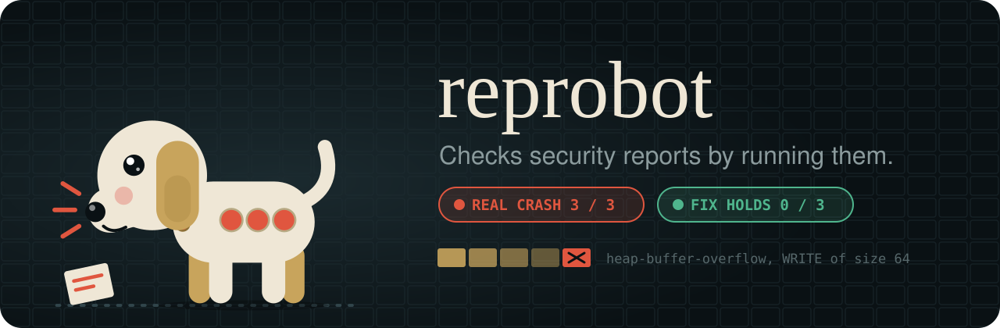
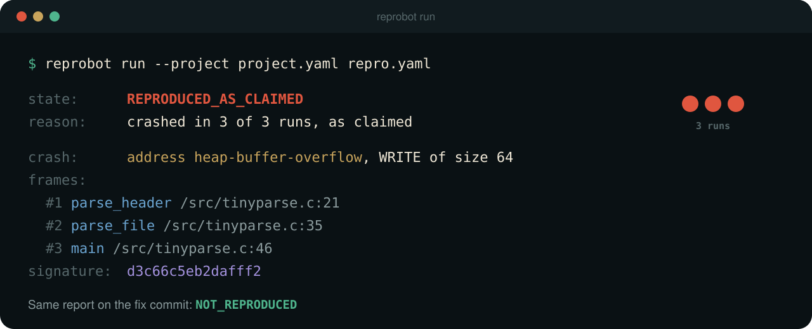
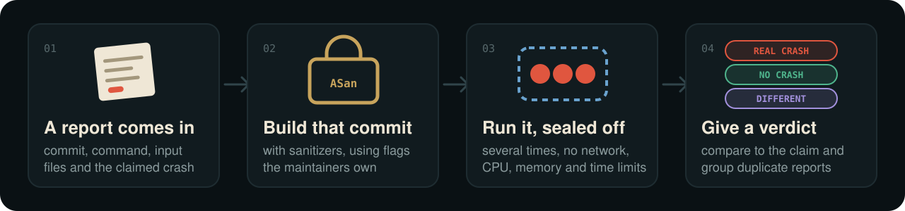

<p align="center">
  
</p>

<p align="center">
  <a href="https://github.com/DCchoudhury15/reprobot/actions/workflows/ci.yml"></a>
  
  <a href="LICENSE"></a>
  <a href="https://reprobot-two.vercel.app"></a>
</p>

<p align="center">
  <a href="#quick-start">Quick start</a> ·
  <a href="#how-it-works">How it works</a> ·
  <a href="#tested-on-real-cves">Real CVEs</a> ·
  <a href="docs/SERVICE.md">Run it as a service</a> ·
  <a href="docs/DESIGN.md">Design</a>
</p>

---

Open source projects get more security reports than they can read, and many
are generated reports about bugs that do not exist. On paper, a well written
fake and a real bug look the same.

**reprobot does not read the report. It runs it.** It builds the exact commit
with sanitizers, runs the proof of concept sealed off from everything, and
tells you whether it really crashed.

<p align="center">
  
</p>

## How it works

<p align="center">
  
</p>

- **The reporter** only sends data: a commit, a command, input files and the
  crash they claim. They pick a build profile by name and cannot touch a
  single build flag.
- **The maintainers** write one `project.yaml`: the repo, the build image and
  the sanitizer builds.
- **Each run** gets no network, a read-only filesystem, no Linux capabilities,
  and CPU, memory and time limits. `repeat` is 5 by default.

<details>
<summary><b>What a reporter sends</b> (a real libxml2 CVE)</summary>

```yaml
version: 1
project: libxml2
commit: cb1b8b8516ade9add9f63fa0e39eaa3bc7034828
profile: asan
run:
  cmd: ["bin/xmllint", "--noout", "--schema", "poc/poc.xsd", "poc/poc.xml"]
  repeat: 3
files: [poc.xsd, poc.xml]
claim:
  sanitizer: address
  kind: SEGV
  frame: xmlSchemaFixupComplexType
```

Bugs in network clients can add up to 4 scripted TCP servers on loopback
(`run.servers`): read a line, send a listed file, wait, close.
</details>

<details>
<summary><b>What the maintainers set once</b></summary>

```yaml
version: 1
id: tinyparse
repo: https://example.org/tinyparse.git
image: gcc:15
profiles:
  asan:
    build: make CFLAGS="-fsanitize=address -g -O1 -fno-omit-frame-pointer"
    outputs: [tinyparse]
limits: {cpus: 1, memory_mb: 1024, build_timeout_seconds: 300}
```
</details>

## Verdicts

| | State | Meaning |
|---|---|---|
| 🔴 | `REPRODUCED_AS_CLAIMED` | crashed, with the claimed kind and frame |
| 🟣 | `REPRODUCED_DIFFERENT` | crashed, but not the way the report says |
| 🟢 | `NOT_REPRODUCED` | no run crashed |
| 🟡 | `FLAKY` | some runs crashed, some did not |
| 🔵 | `TIMEOUT`, `OOM` | hit a limit; may be a real hang, never called fake |
| ⚪ | `BUILD_FAILED`, `INVALID_INPUT` | the input could not be tested |
| ⚪ | `OUT_OF_SCOPE` | the claim is not a crash, so running it cannot test it |

**Duplicates.** Every crash gets a signature (kind plus the top 3 project
frames) and a crash line (the function plus the source text of the line).
Same signature and same line is a duplicate. Same signature on a different
line is shown as "same stack, different line", because that is often a
second bug.

## Why a report cannot fake a crash

Many programs echo bad input in their error messages, so a reporter could
make a fake sanitizer report show up on stderr. reprobot never reads crashes
from stdout or stderr. A crash counts only when all of these hold:

- 🔒 the command is a program the maintainers build, not a script from the report
- 🗝️ the sanitizer writes its report into a log directory that is secret and new for every run
- 🎲 the program exits with an exit code that is also secret and new for every run
- 👀 a watcher outside the program (ptrace, as PID 1 of the run container) sees the exit come from the sanitizer runtime, not from `exit()` in libc, and the report is in the log file of the program's own pid

Before anything is built, a static check also looks for the functions, files
and `file:line` references the report names, in the code at that commit.

## Tested on real CVEs

Eight fixed CVEs in libxml2, jq and curl. Each report is run on the last
vulnerable commit, then again on the fix commit. Only the commit changes.

| Project | Bug | Crash | Vulnerable commit | Fix commit |
|---|---|---|---|---|
| libxml2 | CVE-2025-49794 | heap-use-after-free | 🔴 reproduced | 🟢 gone |
| libxml2 | CVE-2025-49795 | SEGV | 🔴 reproduced | 🟢 gone |
| libxml2 | CVE-2025-49796 | SEGV | 🔴 reproduced | 🟢 gone |
| libxml2 | CVE-2025-24928 | stack-buffer-overflow | 🔴 reproduced | 🟢 gone |
| libxml2 | CVE-2023-28484 | SEGV | 🔴 reproduced | 🟢 gone |
| jq | CVE-2023-50246 | heap-buffer-overflow | 🔴 reproduced | 🟢 gone |
| jq | CVE-2023-50268 | stack-buffer-overflow | 🔴 reproduced | 🟢 gone |
| curl | CVE-2022-42915 | double-free | 🔴 reproduced | 🟢 gone |

Seven fake reports, including a pasted sanitizer report that `xmllint` echoes
back on stderr, all give 🟢 `NOT_REPRODUCED`. A build takes about 30 seconds
and a check on a cached build 1 to 2 seconds.
Full results: [libxml2](eval/libxml2/RESULTS.md), [jq](eval/jq/RESULTS.md), [curl](eval/curl/RESULTS.md) · [how the eval works](eval/README.md)

## Quick start

Needs Go 1.26, git and Docker.

```sh
go install github.com/DCchoudhury15/reprobot/cmd/reprobot@latest
reprobot run --project project.yaml path/to/repro.yaml
```

Try it on `testdata/fixtures/tinyparse`. Exit codes: `0` reproduced as
claimed, `1` any other verdict, `2` usage error, `3` infrastructure error.
Add `--json` for the full result.

**Check a fix.** Add `--fix COMMIT` to run the same report again on the
commit that claims to fix it:

```sh
reprobot run --project project.yaml --fix 71c2ab5 repro.yaml
```

```
fix:       FIXED
reason:    crashed on c9a5156, no crash on 71c2ab5
```

`FIXED` means it crashed on the report commit and not on the fix.
`NOT_FIXED` means it still crashes there. `CANNOT_TELL` means one side gave
no usable answer, for example the report did not reproduce or the fix did
not build. The exit code is `0` only for `FIXED`. With `--sign-key` the
whole fix check is signed. The service does the same when a report is sent
with a `fix_commit` field (see [docs/SERVICE.md](docs/SERVICE.md)).

**Find the commit that added the bug.** Add `--bisect GOOD`, where GOOD is
an older commit on the main line that does not have the bug:

```sh
reprobot run --project project.yaml --bisect v1.0 repro.yaml
```

```
== bisect ==
  7ebe8dc3752b  good  NOT_REPRODUCED         no crash
  52ffc114cf64  skip  BUILD_FAILED           BUILD_FAILED (profile "asan" did not build at 52ffc11), so this commit cannot tell
  967e76a49396  good  NOT_REPRODUCED         no crash
  c83624ec0b6c  good  NOT_REPRODUCED         no crash
  663ae131745f  bad   REPRODUCED_AS_CLAIMED  the same crash

bisect:    FOUND
reason:    the crash first appears in 663ae13; its parent c83624e has no crash
first bad: 663ae131745fbe57821608ea22c413884ddaced3
last good: c83624ec0b6cf2f7f97f33317fa04d0b774b068f
```

It runs the report on GOOD first, then halves the commits between GOOD and
the report commit. A commit counts as bad only with the same crash as on the
report commit; a commit that does not build, times out or crashes another
way is skipped. `FOUND` names the exact commit. `RANGE` means skipped
commits hide it, and gives the last good and first bad commit around them.
`CANNOT_TELL` means the bisect could not start, for example the crash is
already on GOOD. The exit code is `0` only for `FOUND`. The service does the
same with a `good_commit` field.

## Run it as a service

`reprobot serve` takes reports over HTTP and shows result pages.
`reprobot worker` runs them. Both share one Postgres database.

- 🎫 **API tokens.** Reporters see only their own reports; maintainers see their projects.
- ⏱️ **Rate limits.** Each token can send 20 reports an hour by default.
- 🔁 **Safe retries.** The same `Idempotency-Key` never creates a second report.
- ✍️ **Signing.** Workers can sign every result, and the API serves the public key.
- 🐙 **GitHub App.** Private vulnerability reports on GitHub are checked, and the verdict is posted back as a comment on the advisory.

Setup and API: [docs/SERVICE.md](docs/SERVICE.md).

## Signed results

A signed result lets anyone check a verdict without running it again, for
example once it is pasted into an advisory. The signature covers the verdict
and the exact commit, build image and reproducer it was tested with.

```sh
reprobot keygen keys/        # keys/signing.key (keep) and keys/signing.pub (publish)
reprobot run --project project.yaml --sign-key keys/signing.key repro.yaml > result.json
reprobot verify --key keys/signing.pub result.json
```

It is a standard [DSSE](https://github.com/secure-systems-lab/dsse) envelope
signed with Ed25519, so other DSSE tools can check it too.

## Status

Early. What works and what is next:

- ✅ CLI, sandboxed builds and runs, ASan and UBSan, with gcc and clang
- ✅ crash signatures, crash lines and duplicate grouping
- ✅ static claim check and loopback test servers
- ✅ service with tokens, per-token access and rate limits
- ✅ signed results
- ✅ fix check, in the CLI (`--fix`) and the service (`fix_commit`)
- ✅ bisect to the first commit with the crash, in the CLI (`--bisect`) and the service (`good_commit`)
- ✅ GitHub App code for private vulnerability reports (tested against GitHub's documented payloads; not yet run with a registered App)
- ⬜ OSS-Fuzz project import
- ⬜ gVisor as the default sandbox

## Development

```sh
go test ./...                            # unit and database tests (needs Docker)
go test -tags e2e ./internal/runner/     # real sanitizer builds in the sandbox
go test -tags eval -timeout 60m ./eval/  # the real CVE evaluation
```

## License

Apache License 2.0. See [LICENSE](LICENSE).
